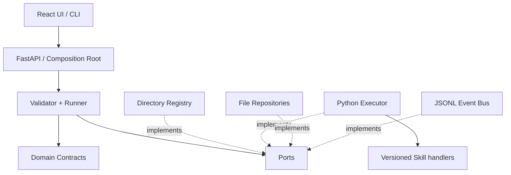
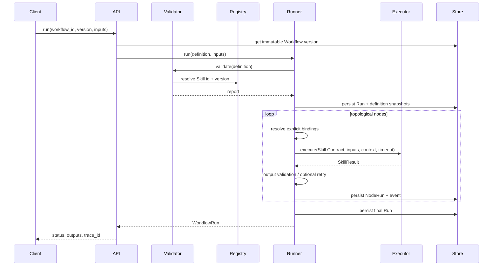
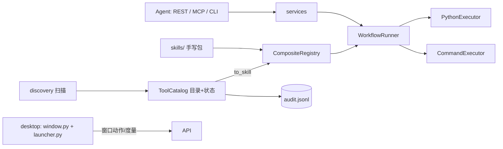

# WorkflowHub 架构报告

## 1. 系统架构与边界

本轮交付以 Skill Contract、Registry、Workflow DAG、静态校验和确定性执行为主线。自然语言规划、人工复核恢复、条件分支、并行调度和 Marketplace 保留接口或模型，不进入当前执行路径。

| 边界 | 职责 | 当前实现 |
| --- | --- | --- |
| API / UI | 接受定义、展示能力与运行结果 | FastAPI 基础 REST；React 示例页 |
| Application | 校验、调度、重试、Trace | `WorkflowRunner`、`WorkflowValidator` |
| Domain | Skill/Workflow/Run/Artifact/Review Contract | Pydantic 严格模型 |
| Infrastructure | 发现、执行、版本与运行记录、事件 | YAML Registry、Python 子进程、文件仓储、JSONL |
| External capability | 各 Skill 的实际业务行为 | `skills/*/handler.py` |

依赖规则：API 与 CLI 通过组合根装配接口；Runner 依赖 Registry、Executor、RunRepository、EventBus 的协议，不依赖具体 Skill。Skill 只通过 JSON 标准输入输出与 Python Executor 通信。Planner 未来只产出 `WorkflowDefinition` 草案，必须经过相同校验后才能保存与执行。

## 2. 核心实体与关系

- `SkillDefinition`：由 `id + version` 标识；含字段 Schema、Executor 声明、权限、依赖、超时、重试策略。`ValueSpec` 是输入输出字段契约。
- `WorkflowDefinition`：由 `id + version` 标识的不可覆盖版本；包含 `WorkflowNode`、`WorkflowEdge`、Workflow 输入、输出绑定。一个 Skill 可以出现在多个 Node 中。
- `InputBinding`：`literal / workflow_input / node_output / context` 四种显式来源；Node 间引用须有直接依赖边。
- `WorkflowRun`：一次运行独立于定义，持有完整 Workflow 快照、固定 `workflow_version_id`、Trace ID、状态与输出。
- `NodeRun`：持有固定 `skill_id + skill_version` 和当时的 Skill Contract 快照、输入、尝试次数、结构化结果。
- `SkillResult`：统一状态、输出、Artifact、日志、指标、错误和时间戳。
- `Artifact`：文件位置、媒体类型、大小与来源 Node Run。
- `ReviewTask`：预留人工决策数据模型；执行器返回 `WAITING_REVIEW` 时 Run 进入 `WAITING` 并记录待审任务。当前不支持恢复调度，也拒绝显式 `human_review` Node，防止把未实现能力误判为成功。

当前文件仓储保存发布后的 Workflow 版本及每次 Run 快照。`docs/architecture/schema.sql` 描述未来迁到 SQLite / PostgreSQL 的持久化关系模型；存储适配器替换不改变 Runner。

## 3. 核心接口

`ports.py` 定义 `SkillExecutor`、`SkillRegistry`、`SkillRepository`、`WorkflowRepository`、`RunRepository`、`SkillSearchProvider`、`LLMProvider`、`ArtifactStorage`、`SecretProvider`、`EventBus`。执行器路由按 `executor.type` 动态选择。当前实现本地目录 Registry、关键词检索、Python Executor、文件仓储及 JSONL EventBus。其余端口刻意保留，实现时在组合根注册即可。

## 4. 数据与执行流

目录扫描会完整解析 `skills/<id>/skill.yaml` 与可选的 `skills/<id>/versions/<version>/skill.yaml`，用 Pydantic 严格校验，并确认执行文件在对应 Skill 目录内。版本目录允许旧实现与新实现并存。扫描成功后原子替换内存 Registry；失败时保留旧快照。定义发布前进行 DAG、Skill 版本、必填字段、绑定类型、依赖、执行器与权限校验。每次执行再次校验，随后固定 Workflow 和 Skill Contract 快照。

Runner 以稳定拓扑顺序执行当前 MVP 的 Skill Node。每个 Node 先解析显式绑定，再做运行时输入校验。Python Executor 以 JSON stdin/stdout 协议调用独立进程；超时会杀死进程。返回值再次验证输出契约。重试只由 Runner 按 Skill 的策略执行。状态变化写入 Run JSON 与结构化 JSONL 事件。若某节点失败，后续节点标记 `SKIPPED`，Run 保留结构化错误。

## 5. 关键决策与限制

1. Workflow 的内容版本发布后不可覆盖；Run 还保存定义快照，历史解释不依赖当前文件。Skill 执行记录也保存当时的 Contract 快照。目录可并存多个 Skill 版本；未来若要强保证旧代码重放，应增加不可变包或内容哈希的发布仓库。
2. Python Skill 被视作不可信扩展。当前有权限声明检查、输入输出验证、执行路径限制、Artifact 路径校验和进程超时；**本地子进程不是安全沙箱**。仅加载可信本地 Skill。完整隔离与密钥注入需后续专用执行环境。
3. 当前调度按 DAG 顺序单节点执行；`DAG.ready_nodes` 已为并行调度提供基础，分支、复核恢复、取消和分布式 Worker 均未实现。
4. 版本化 JSON 仓储满足本轮骨架与可追踪演示。SQL Schema 是下一阶段数据库适配器的契约草图，当前运行不依赖 SQLite。
5. 基础 UI 只显示示例图、发现的 Skill 和 Run 结果；不是完整 Workflow Builder。

## 6. 下一阶段接入规则

- 新 Skill：新增 `skills/<id>/skill.yaml` 与实现，刷新 Registry；不得改 Runner。
- 新 Executor：实现 `SkillExecutor`，在组合根注册 `executor.type`；不得改 DAG 或绑定逻辑。
- 新 Search/LLM Provider：实现各自 Port；Planner 的结构化草案先过 Schema 与 WorkflowValidator。
- 新存储：实现 `WorkflowRepository` / `RunRepository`，保持版本不可覆盖与运行记录快照。

## 7. 本机能力接入（交付版新增）

交付版把"只跑示例骨架"扩成"能接管这台电脑的工具面"，新增四个模块，**没有改** DAG、绑定、
校验与 Runner 的语义：

| 模块 | 职责 |
| --- | --- |
| `discovery.py` | 只读扫描：PATH 可执行文件、Windows 内置命令、注册表已安装应用、脚本工具（含从 `add_argument` / `param()` / `process.argv` 推断参数）、项目 npm/make 入口、别人的 Skill 包与 CI 蓝图 |
| `catalog.py` | 工具目录与状态：持久化扫描结果、启用/星标/备注别名/手动登记、风险分级、审批队列、审计、把条目转成 `SkillDefinition` |
| `command_executor.py` | `executor.type = "command"`：exec 语义启动进程（无 shell）、参数渲染、输出编码兜底、字节上限、超时杀进程、stdout/stderr 落为 Artifact |
| `services.py` | REST / MCP / CLI 共用的服务层：单次调用被表达成"一个节点的临时 Workflow"，因此与手搓 DAG 走同一条链路 |

要点与取舍：

1. **目录不是第二套执行模型。** 发现的工具变成普通 Skill 契约（`inputs.argv/flags/stdin/…`），
   所以校验器、快照、trace、重试策略全部复用；新增 executor 类型即可，不改调度。
2. **必填参数只声明不强制。** 脚本源码里 `required=True` 的参数在契约描述中标注"脚本要求必填"，
   但 `ValueSpec.required=False`：否则 Agent 连 `--help` 都调不动，而命令自己会给出更准确的报错。
3. **蓝图条目不可调用。** 没有命令入口的条目（CI 工作流、只有 skill.yaml 的 Skill 包、找不到 exe 的应用）
   标为 `blueprint`，`is_enabled` 直接返回 False；Skill 包提供"接入为本地 Skill"动作，复制到 `skills/` 后才参与执行。
4. **Agent 侧的上下文预算。** MCP 默认只暴露 8 个元工具（先 search 再 invoke），`--expose-tools`
   才逐工具暴露；REST 的 `/api/v1/tools.json` 供 function calling 一次性取全量 schema。
5. **桌面外壳与核心解耦。** `desktop/window.py` 只做 Win32（裁掉 Chromium 自绘工具条、几何控制、
   图标、PrintWindow 取证），页面通过 `/api/v1/window/*` 上报视口高度并下发拖拽/缩放/最大化动作；
   在浏览器里访问时这些端点返回"非桌面模式"，界面显示"浏览器预览"而不是假装能控制窗口。详见
   [ADR-006](ADR-006-machine-tool-catalogue.md) 与 [ADR-007](ADR-007-borderless-desktop-shell.md)。
6. **旧契约只是第五张脸。** `legacy_agent_api.py` 提供其余项目那套四端点（`/api/health`·
   `/api/agent/tools`·`/api/agent/manifest`·`POST /api/agent/tool`），信封是旧的，但里面走的是同一个
   `services.invoke_tool`：风险开关、审批、审计、错误文本一律与 REST 一致（测试同时断言两面拿到同一个
   `command_line`）。两处有意的差别写在 `manifest.conventions` 里：工具清单是分页视图（默认 200、上限
   1000），命令跑通但退出码非 0 回 `200 + ok:false` —— 不让客户端把已经有副作用的命令当传输错误重发。
7. **"端口开着"不等于"服务可用。** 启动就绪判据是 `GET /health` 必须带本次实例身份（`Hub.instance`）；
   应答对不上就换端口重试（最多 6 次），服务线程的真实异常也会写进 `data/desktop.log`。这台机器上还有
   一层会接受任意本地端口连接却不回话的东西，所以"连接被拒绝"不能拿来判活，只有真的收到 HTTP 应答才算。
   Chromium Profile 同理：固定复用 `data/browser-profile/`，只清理端口已经没有应答的旧目录。

